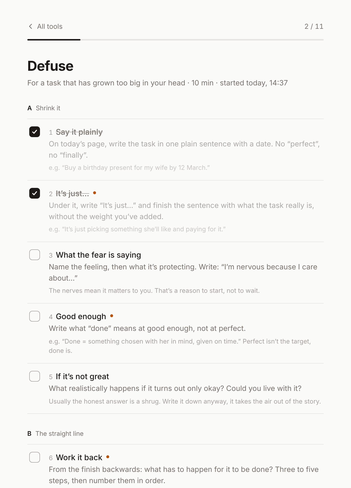

# Defuse

**For a task that has grown too big in your head. Shrink it back to its real size, find the straight line, make the first move.**

[**→ Open the app**](https://marekbrze.github.io/bullet-journal-tools/defuse/) &nbsp;·&nbsp; [Download the file](https://raw.githubusercontent.com/marekbrze/bullet-journal-tools/main/defuse/index.html)

 

<picture>
  <source media="(prefers-color-scheme: dark)" srcset="docs/defuse-dark.png">
  
</picture>

 

Some tasks are small on paper and huge in your head: buying a present, booking a doctor, an awkward email. Defuse is a checklist for your notebook that takes the extra weight off and turns the task into a few plain steps.

## Eleven steps, about ten minutes

| | |
|:-:|---|
| **A · Shrink it** | Say it plainly, with a date. “It's just…”. What the fear is protecting (usually: you care). What “done” means at good enough. What realistically happens if it's only okay. |
| **B · The straight line** | Work it back from the finish into three to five steps (with an example), cut anything that's only there to look impressive, turn question marks into “find out”, give each step a day. |
| **C · Move** | The first step, small enough for six minutes, done now with [Start](../start/). Afterwards one line: what it actually was like, as evidence for next time. |

The weekly review links here from the step where you split big tasks.

 

Bullet Journal® is a trademark of Ryder Carroll. This is an independent project, not affiliated with the method's author or bulletjournal.com.

