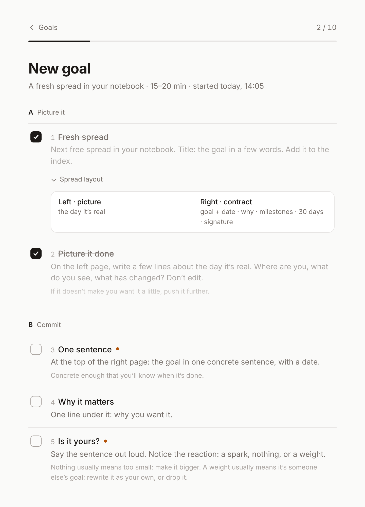

# Goals

**Checklists for setting a goal in your notebook and checking in on it every month.**

[**→ Open the app**](https://marekbrze.github.io/bullet-journal-tools/goals/) &nbsp;·&nbsp; [Download the file](https://raw.githubusercontent.com/marekbrze/bullet-journal-tools/main/goals/index.html)

 

<picture>
  <source media="(prefers-color-scheme: dark)" srcset="docs/goal-dark.png">
  
</picture>

 

You write the goal in your notebook, by hand. The app only walks you through it, one step at a time, like the [Reviews](../reviews/).

## Two checklists

| | |
|:-:|---|
| **New goal** | 10 steps · a fresh spread: the picture of it done on the left; on the right one sentence with a date, why it matters, the “is it yours?” check, milestones worked backwards, a 30-day habit and your signature. Ends with today's smallest step, which you can do with [Start](../start/). |
| **Check-in** | 8 steps · once a month or when the 30 days are up: reread, still yours?, milestones, what moved, the next 30 days and today's step. |

The home screen marks the check-in as due four weeks after the last one. History and Export / Import work like in the Reviews.

 

Bullet Journal® is a trademark of Ryder Carroll. This is an independent project, not affiliated with the method's author or bulletjournal.com.

