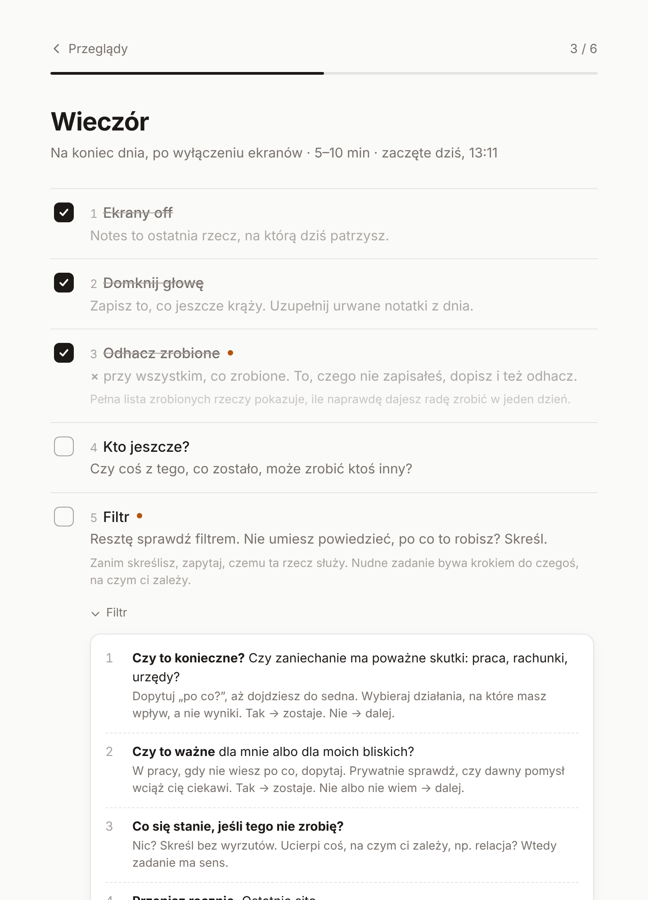
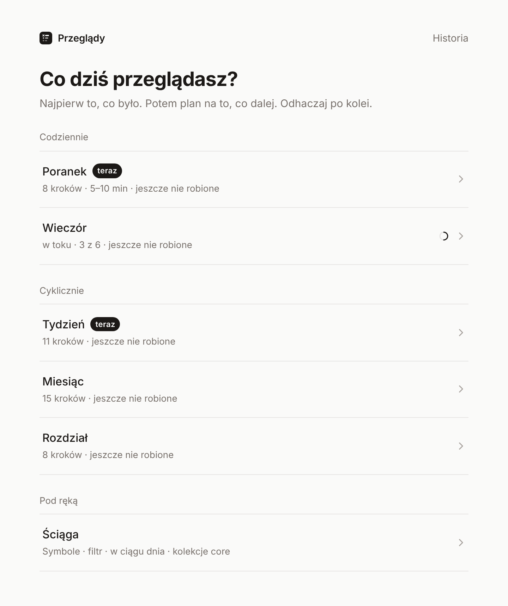

[English](README.md) · **Polski**

# Przeglądy

**Checklisty przeglądów papierowego notesu. Otwierasz, odhaczasz po kolei, zamykasz.**

[**→ Otwórz aplikację**](https://marekbrze.github.io/bullet-journal-tools/przeglady/) &nbsp;·&nbsp; [Pobierz plik](https://raw.githubusercontent.com/marekbrze/bullet-journal-tools/main/przeglady/index.html)

 

<picture>
  <source media="(prefers-color-scheme: dark)" srcset="docs/checklist-dark.png">
  
</picture>

 

Przegląd notesu ma kilkanaście kroków i łatwo jakiś pominąć, zwłaszcza miesięczny. Ta aplikacja prowadzi przez każdy przegląd krok po kroku: najpierw to, co było, potem plan na to, co dalej. Kroki opisałem własnymi słowami na podstawie tego, jak sam prowadzę notes metodą Bullet Journal®.

## Pięć przeglądów

| | |
|:-:|---|
| **Poranek** | 8 kroków · nowy log dzienny, 3 priorytety dnia |
| **Wieczór** | 6 kroków · <code>×</code> na zrobionym, reszta przez filtr, nagłówek dnia |
| **Tydzień** | 11 kroków · refleksja na lewej stronie, zadania i intencja na prawej |
| **Miesiąc** | 15 kroków · refleksja z pytaniami, migracja, 3 + 3 |
| **Rozdział** | 8 kroków · chapter log z czterema polami, przejście do nowego notesu |

Plus **Ściąga**: symbole, filtr, zasady zapisywania w ciągu dnia i kolekcje core.

<picture>
  <source media="(prefers-color-scheme: dark)" srcset="docs/home-dark.png">
  
</picture>

## Co potrafi

- **Pamięta, gdzie skończyłeś.** Odhaczenia zapisują się od razu. Zamkniesz kartę w połowie, wrócisz do tego samego miejsca.
- **Podpowiada, co teraz.** Rano poranek, wieczorem wieczór, tydzień po tygodniu, miesiąc na przełomie miesięcy.
- **Filtr pod ręką.** Kroki, w których przenosisz zadania, mają rozwijany filtr.
- **Historia.** Każdy zamknięty przegląd trafia do historii z czasem trwania. Przy codziennych widać serię dni z rzędu.
- **Klawiatura.** `X` odhacza następny krok, `Z` cofa, `↑` `↓` poruszają.
- **Po polsku i po angielsku.** Język dobiera się według przeglądarki, przełącznik jest w stopce. Postęp i historia zostają przy zmianie języka.
- **Prywatnie, jeden plik.** Bez konta i serwera. Pobierz `index.html` i otwórz z dysku, także offline.

<b>Kopia zapasowa i przenoszenie danych</b>

 

Dane leżą w `localStorage` przeglądarki. Pobrany plik i wersja online nie widzą swoich danych nawzajem. Do przenoszenia i kopii zapasowej służy **Eksport / Import** w stopce.

<b>Jak zmienić treść kroków</b>

 

Treść jest w obiekcie `CONTENT` na początku skryptu w `index.html`: `CONTENT.pl` to oryginał, `CONTENT.en` jego tłumaczenie. Obie wersje muszą mieć tę samą strukturę (te same id i liczbę kroków), bo postęp zapisuje się po pozycji kroku. Teksty interfejsu są w obiekcie `UI`. Każdy krok ma tytuł (`t`), opis (`d`), opcjonalną podpowiedź (`s`), flagę kluczowego kroku (`key`) i opcjonalny dodatek (`extra`: filtr, pytania, układ rozkładówki). `{•}` w tekście renderuje się jako symbol z legendy.

 

Bez instalacji · bez konta · bez śledzenia · działa na telefonie i w trybie ciemnym

Bullet Journal® jest znakiem towarowym Rydera Carrolla. To niezależny projekt, niezwiązany z autorem metody ani z bulletjournal.com.

