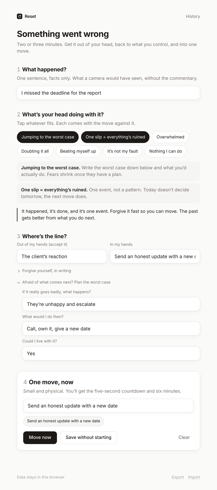

# Reset

**Something went wrong and your head is running the worst version of it. Two or three minutes back to what you control, then one move.**

[**→ Open the app**](https://marekbrze.github.io/bullet-journal-tools/reset/) &nbsp;·&nbsp; [Download the file](https://raw.githubusercontent.com/marekbrze/bullet-journal-tools/main/reset/index.html)

 

<picture>
  <source media="(prefers-color-scheme: dark)" srcset="docs/reset-dark.png">
  
</picture>

 

Reset is short on purpose. It doesn't ask you to analyse the setback, it gets you out of the spiral and back into motion.

## Four parts, one page

| | |
|:-:|---|
| **1** | **What happened**, in one sentence, facts only. |
| **2** | **What your head is doing with it.** Tap the patterns that fit (worst case, one slip = everything, overwhelmed, doubting, beating yourself up, blaming, helpless) and each shows the move against it. |
| **3** | **Where the line is**: what's out of your hands, what's in them. Optional: forgive yourself in writing, or plan the worst case (what happens, what you'd do, could you live with it). |
| **4** | **One move, now.** Pick what's in your hands or today's step from one of your [Goals](../goals/), and it opens [Start](../start/) with the countdown. |

The history shows which patterns come up most, so you know what to watch for.

 

Bullet Journal® is a trademark of Ryder Carroll. This is an independent project, not affiliated with the method's author or bulletjournal.com.

