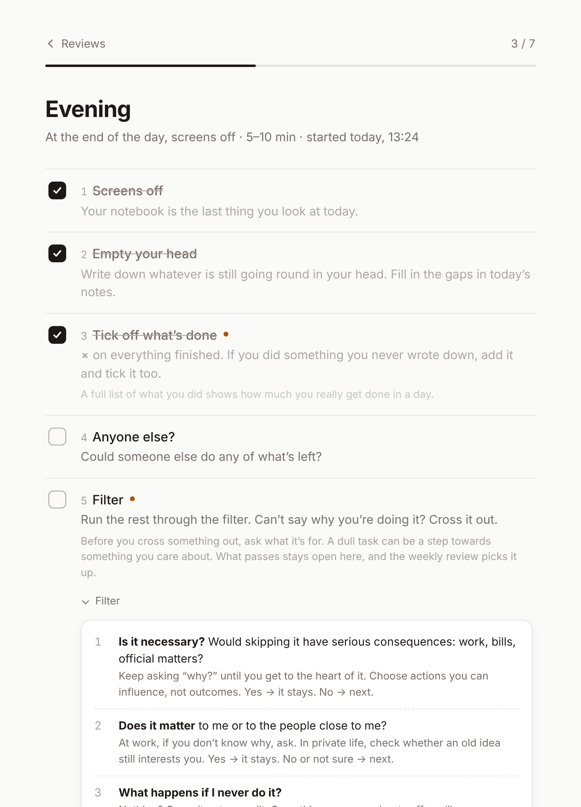
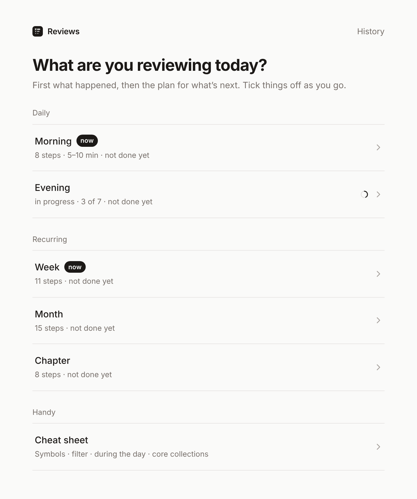

# Reviews

**Review checklists for a paper notebook. Open one, tick the steps off in order, close it.**

[**→ Open the app**](https://marekbrze.github.io/bullet-journal-tools/reviews/) &nbsp;·&nbsp; [Download the file](https://raw.githubusercontent.com/marekbrze/bullet-journal-tools/main/reviews/index.html)

 

<picture>
  <source media="(prefers-color-scheme: dark)" srcset="docs/checklist-dark.png">
  
</picture>

 

A notebook review has a dozen or so steps, and it's easy to skip one, especially in the monthly review. This app walks you through each review step by step: first what happened, then the plan for what's next. The steps are written in my own words, based on how I keep my notebook with the Bullet Journal® method.

## Five reviews

| | |
|:-:|---|
| **Morning** | 8 steps · new day page, three priorities for the day |
| **Evening** | 7 steps · <code>×</code> on what's done, the rest through the filter, dates to the right place, a headline for the day |
| **Week** | 11 steps · reflection on the left page, tasks and intention on the right |
| **Month** | 15 steps · reflection with prompts, migration, 3 + 3 |
| **Chapter** | 8 steps · chapter log with four boxes, moving to a new notebook |

Plus a **Cheat sheet**: symbols, the filter, how to log during the day and the core collections.

<picture>
  <source media="(prefers-color-scheme: dark)" srcset="docs/home-dark.png">
  
</picture>

## What it does

- **Remembers where you stopped.** Ticks are saved right away. Close the tab halfway through and you'll come back to the same place.
- **Suggests what's next.** Morning review in the morning, evening review in the evening, weekly after a week, monthly around the turn of the month.
- **Filter at hand.** Steps where you move tasks have the filter one click away.
- **History.** Every finished review goes into the history with how long it took. Daily reviews show your streak.
- **Keyboard.** `X` ticks the next step, `Z` undoes, `↑` `↓` move.
- **Private, one file.** No account, no server. Download `index.html` and open it from your disk, offline too.

<b>Backup and moving your data</b>

 

Data lives in the browser's `localStorage`. The downloaded file and the online version don't see each other's data. Use **Export / Import** in the footer to move it or back it up.

<b>Editing the steps</b>

 

The content is in the `C` object at the top of the script in `index.html`, interface strings in `T`. Progress is stored by step position, so after adding or removing a step in a review, an unfinished run of that review may show the wrong ticks. Each step has a title (`t`), a description (`d`), an optional hint (`s`), a key-step flag (`key`) and an optional extra (`extra`: filter, prompts, spread layout). `{•}` in the text renders as a symbol from the legend.

 

No install · no account · no tracking · works on mobile and in dark mode

Bullet Journal® is a trademark of Ryder Carroll. This is an independent project, not affiliated with the method's author or bulletjournal.com.

