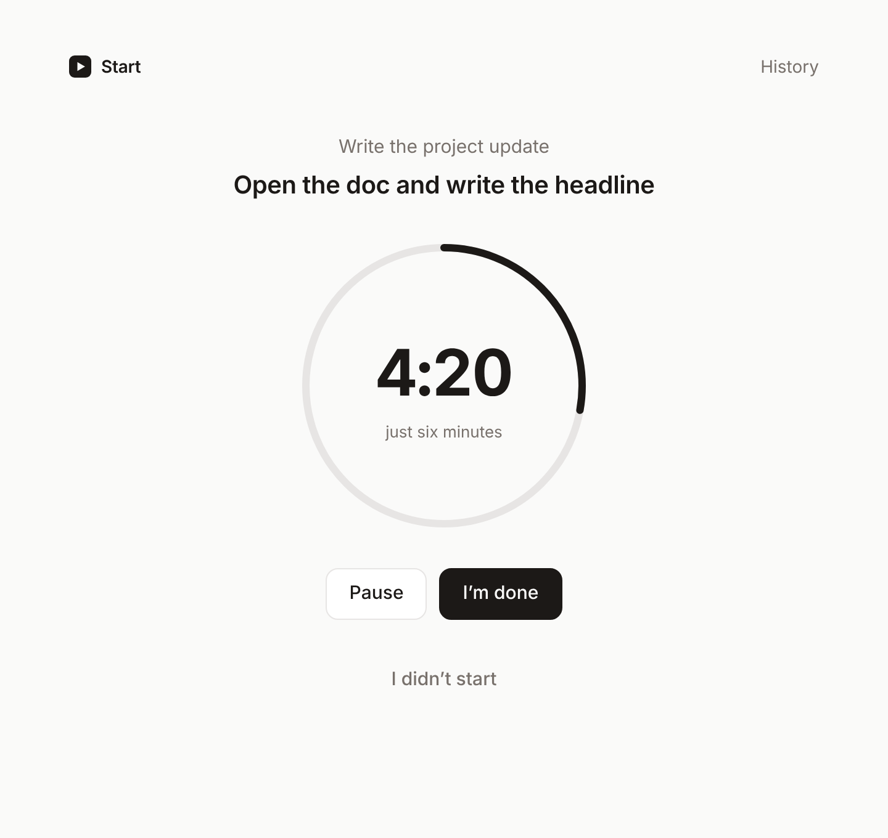

# Start

**For when you keep putting something off. Smallest step, five seconds, six minutes.**

[**→ Open the app**](https://marekbrze.github.io/bullet-journal-tools/start/) &nbsp;·&nbsp; [Download the file](https://raw.githubusercontent.com/marekbrze/bullet-journal-tools/main/start/index.html)

 

<picture>
  <source media="(prefers-color-scheme: dark)" srcset="docs/timer-dark.png">
  
</picture>

 

Most of the time the hard part isn't the work, it's the first minute. Start gets you through that minute and doesn't ask you to think about why you've been avoiding it.

## How it works

| | |
|:-:|---|
| **1** | **Name the task** you keep putting off. |
| **2** | **Pick the smallest step**, something physical you can start now and do in six minutes. |
| **3** | **Count down from five** and move on zero. |
| **4** | **Work for six minutes.** Then keep going or stop. Both count. |

Didn't start? That usually means the step was still too big. The app asks you to make it smaller and try again.

## When the resistance is strong

Two optional helpers on the step screen, each under a minute or three:

- **Untangle the excuse.** “I'm not doing it because…” is two separate facts glued together. Seeing them apart makes it easier to feel the second and still do the first.
- **Picture it going well.** Ask what becomes possible once the task feels easy, then picture it for up to three minutes until you catch a bit of excitement.

## Also

- **No history.** It's a quick shot: nothing is logged, nothing to review later.
- **Survives a reload**: a running timer keeps going if you close the tab.
- **Keeps the screen on** during the timer where the browser allows it. Sound and vibration at the end, with a mute switch.
- **Can be opened with a task**: `start/index.html?task=Write%20the%20report` goes straight to the step screen. Goals and Reset use this.
- **One file**: no account, no server.

 

Bullet Journal® is a trademark of Ryder Carroll. This is an independent project, not affiliated with the method's author or bulletjournal.com.

